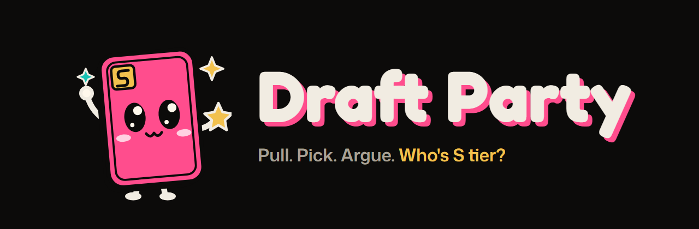
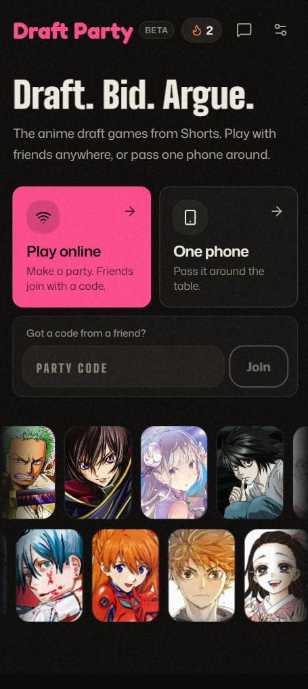
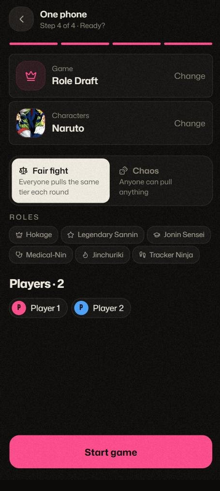
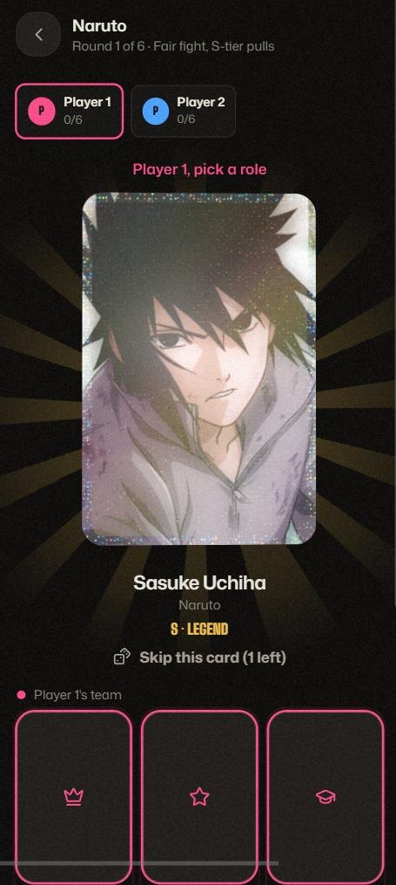
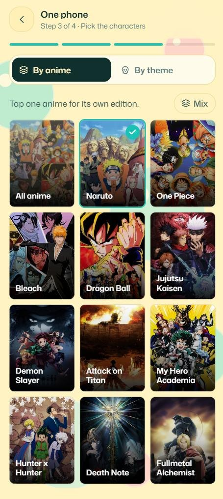
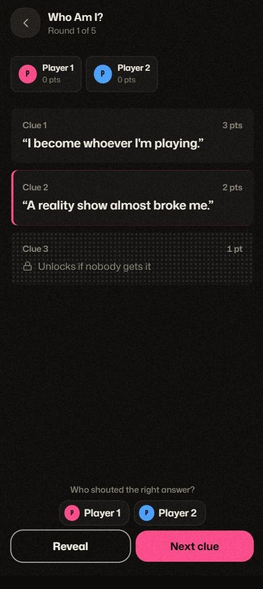
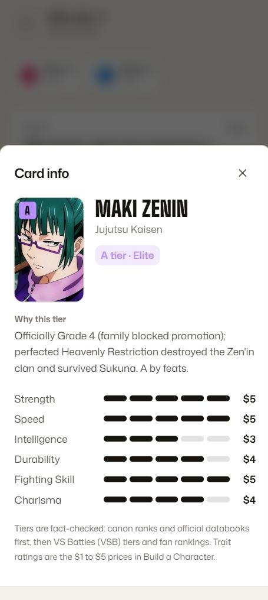
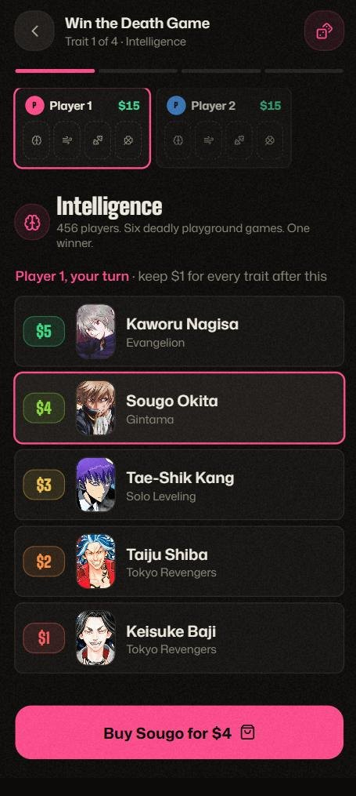

**Draft. Bid. Argue.** The anime draft games from YouTube Shorts, now playable with your friends, wherever they are.

### [Play now at draftparty.me: free, no sign-up](https://draftparty.me)

*Early beta. Feedback very welcome.*

**New:** [Meet Kida: why I built Draft Party](https://draftparty.me/blog/meet-kida), the story behind the game.

---

Love those Shorts where people draft an anime team, bid $20 on characters, or spend $15 building someone who survives a death game? Now you can actually play them. Create a room, send the link to your friends (even in another country), and argue about who won.

  
  
  

## Play online with friends

- **One tap to make a room.** Share the link or read out the 5-letter code. No account, no download.
- **Up to 8 players** in Draft, Auction and Guess Who, 6 in Build a Character and Perfect Anime Draft, 10 in Who Am I?, Anime Imposter, Closest and Forehead (3 or more for Imposter and Forehead). Friends who join mid-game watch the round, then play the next one.
- **Refresh-proof.** Lose signal or close the tab and you get your seat back.
- **Or play on one phone** and pass it around the table.
- **No friends around?** Role Draft works solo with a score to beat, and the Daily Draft has a world leaderboard.
- **Keep your streak on every device.** Signing in is optional: use Google or a 6-digit email code, and your Daily Draft streak, results and nickname follow you.

## Pick an anime, get its own edition

Tap an anime and the game changes to fit it. Naruto drafts into **Shinobi, Ninjutsu, Taijutsu, Dojutsu, Chakra Nature, Kekkei Genkai and Speed**; Jujutsu Kaisen into Sorcerer, Cursed Technique, Domain and Barrier Techniques, Cursed Energy, Physical Abilities, Special Traits and Speed. Every pick fits every slot, so the fight is over whose Speed is better. All 40 anime have their own roles, including Death Note, Mob Psycho 100, Cyberpunk: Edgerunners, Frieren, Solo Leveling and Dandadan.

Play all anime or your own mix and you draft a full team instead: **Captain, Vice Captain, Tank, Healer, Support, Duelist, Technique and Aura.**

**Fact-checked rankings.** Every one of the 921 characters has a researched tier and trait ratings, based on official databooks, canon ranks and fan consensus. Tap any card to read why. No more Temari above Tobirama. Every tier is also public: **[anime tier lists](https://draftparty.me/tier-list)** for all 40 anime.

  
  
  

## Or pick a theme

Themes run across all 40 anime, each with its own six roles: **Villains, Mentors, Dads, Moms, Rivals, Swordsmen, Geniuses, Main Characters, Anti-Heroes, Siblings, Monsters & Demons, Tragic Characters, Comic Relief, Best Friends, Overpowered, Must Protect, Captains and Underdogs.**

## Game modes

| Mode | How it works |
|---|---|
| **Role Draft** | Take turns pulling blind cards into roles. One skip each. *Fair fight* gives everyone the same tier every round. *Beat the Boss*: the anime's final boss sits out and sets a team power to beat. *All at once*: online, everyone pulls and places together. *Solo*: 1 player, your team is scored Power × role, so chase your best. |
| **Mystery Auction** | $20 each. Bid on a mystery character from a clue and build a team of 4. Names are revealed at the end. *Mixed clues* mixes stat lines, canon groups, traits and story clues. *Crowd pleasers* keeps the lots to well-known faces; *Deep lore* lets anyone in. |
| **Perfect Anime Draft** | $20 to build the perfect anime from parts of real ones: Main Character, Power System, Villain, Signature Move, Opening, Ending. Curses pay you to take them. Then vote on which anime you'd actually watch. |
| **Build a Character** | $15, four traits, at least five characters per trait priced $1 to $5 by how good they really are at that trait. Take turns buying: once a pick is bought, it's gone. Then argue who wins the event. |
| **Who Am I?** | Three clues per character, hardest first. The first to answer right takes the round: 3 points on the first clue, 2 on the second, 1 on the last. *Race mode*: first to N characters wins. |
| **Anime Imposter** | Everyone sees the same secret character except the imposter, who only knows the anime. Give one- or two-word clues, then vote. A caught imposter gets one guess to steal the round. |
| **Closest Without Going Over** | Name the #N on a real AniList ranking without going past it. Bullseye 5, then 3/2/1 for the closest. Double Down once per game. Works solo too. |
| **Anime Guess Who** | 24-character boards, a secret pick each, question cards answered from the character data, and a blind early guess for 2 points. Online. |
| **Forehead** | Everyone sees your character but you. Ask yes/no questions; Kinda earns a free question; a hot seat of one-word hints after 5. Online. |
| **Daily Draft** | Everyone in the world gets the same 9 cards each day for the same eight roles. Captain counts ×3, Vice Captain ×2. One skip, one try. Beat your friends and keep your streak. |

When the teams are full, **the room votes** on who won. Your own team counts, and a split vote goes to the stronger team on paper. Who Am I?, Anime Imposter, Closest, Guess Who and Forehead are scored. Then save a share image for the group chat, and climb the Daily Draft leaderboard.

  

## Follow

TikTok and Instagram [@play.draftparty](https://www.instagram.com/play.draftparty/), Facebook [play.draftparty](https://www.facebook.com/play.draftparty).

## Feedback

This is a student project in early beta. There's a **Feedback** button in the app, or open an [issue](../../issues), or reach me on GitHub [@MZRMRB](https://github.com/MZRMRB). Which anime or theme should come next?

Earlier versions are still online: [V2](https://draft-party-v2.anime-draft-party.workers.dev) · [V1](https://draft-party-v1.anime-draft-party.workers.dev)

---

Fan-made and unofficial. Not affiliated with any anime studio or publisher. Character names and images belong to their owners. Character data from <a href="https://anilist.co">AniList</a>.
