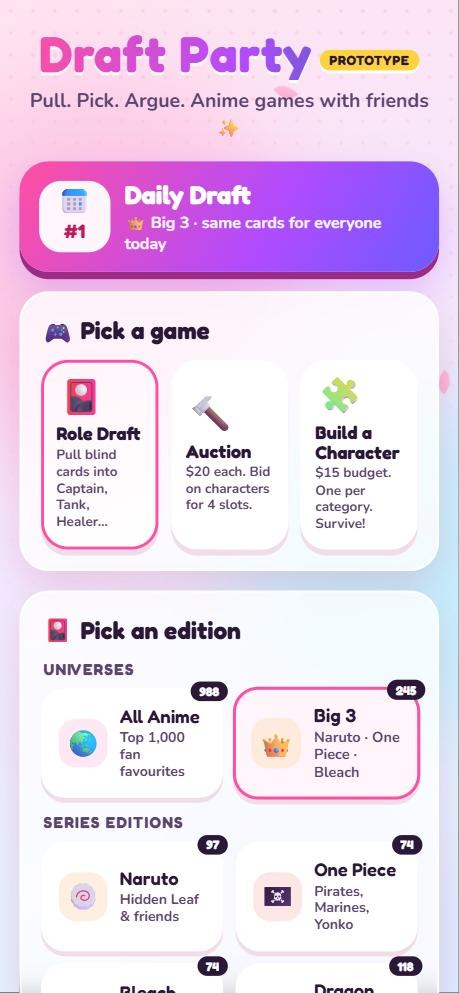
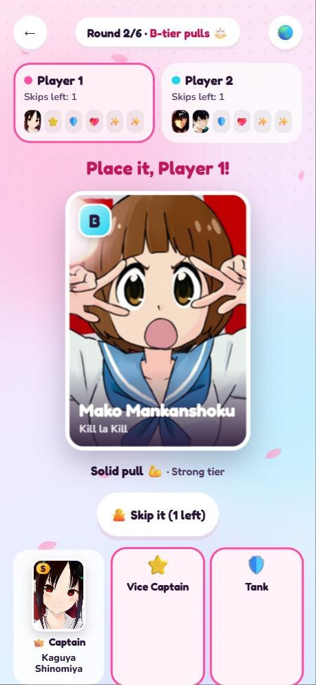
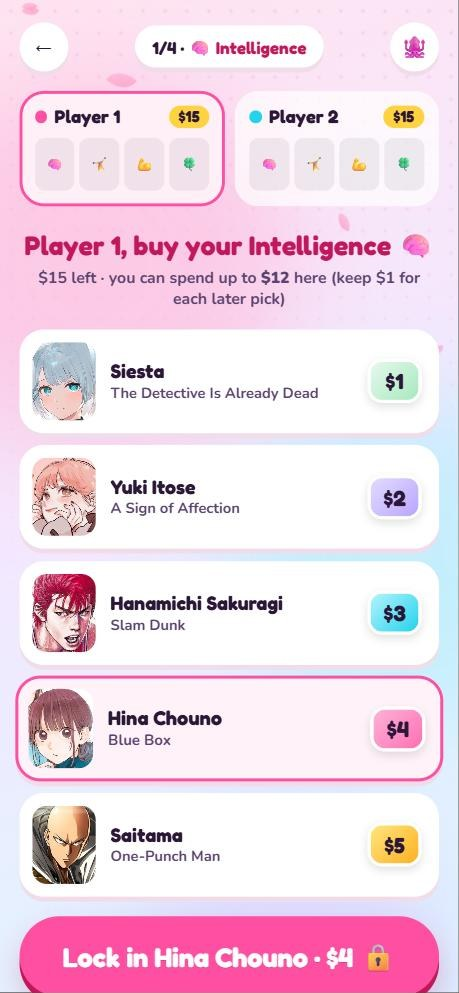
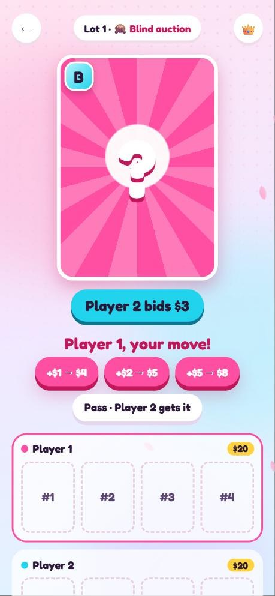
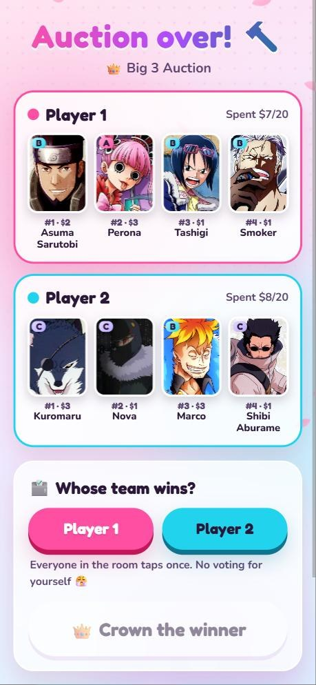
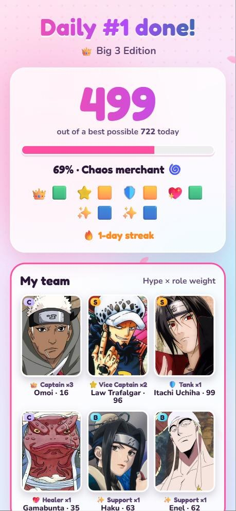
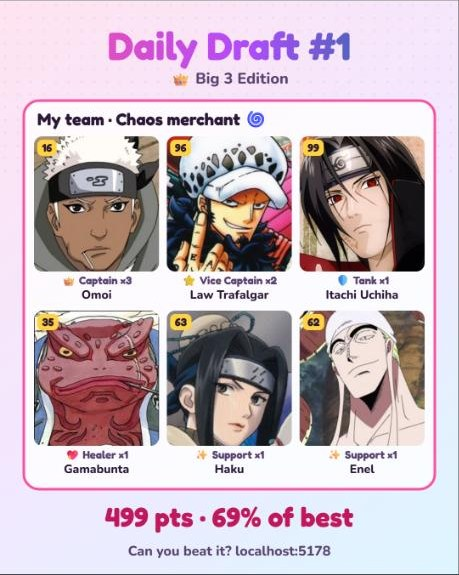

# 🌸 Draft Party

**Pull. Pick. Argue.** The anime draft games from YouTube Shorts, now playable with your friends.

### [▶️ Play now: free, no sign-up](https://draft-party.anime-draft-party.workers.dev)

*Early prototype. Tell me what you think!*

---

Love those Shorts where two people draft an anime team, bid $20 on characters, or spend $15 to build someone who survives a death game? There was no way to actually *play* them with friends. Now there is. Grab one phone, pass it around, argue about who won.

  
  
  

## 🎮 Game modes

| Mode | How it works |
|---|---|
| 🎴 **Role Draft** | Take turns pulling blind cards into **Captain, Vice Captain, Tank, Healer, Support**. One skip each. *Fair fight* makes both players pull from the same tier every round. |
| 🔨 **Auction** | $20 each, 4 slots. One character goes up at a time: raise or pass. **Blind mode** hides who you're bidding on until the big reveal. |
| 🧩 **Build a Character** | $15, four categories, five characters priced $1–$5. Buy in secret, then reveal. *Survive the Death Game, Zombie Apocalypse, City Invasion, Perfect Date…* |
| 📅 **Daily Draft** | Everyone in the world gets the same 7 cards today. Captain ×3, Vice ×2. Beat your friends' score and keep your streak 🔥 |

When the teams are full, **the room votes** on who won. Then save a share image for your group chat or story.

  
  
  

   
  Every game makes a share image like this one.

## 🗂️ Editions

**All Anime** (top 1,000 fan favourites) · **Big 3** · Naruto · One Piece · Bleach · Dragon Ball · Jujutsu Kaisen · Demon Slayer · Attack on Titan · Black Clover · My Hero Academia · Hunter x Hunter · **Villain** · **Mentor** · **Dad** editions, each with its own roles (Final Boss, Spy, Fun Dad…).

## 💬 Feedback

This is a student project and an early prototype. Which mode did you play most? What edition should come next? Open an [issue](../../issues) or reach me on GitHub [@MZRMRB](https://github.com/MZRMRB).

---

Fan-made and unofficial. Not affiliated with any anime studio or publisher. Character names and images belong to their owners. Character data from <a href="https://anilist.co">AniList</a>.
