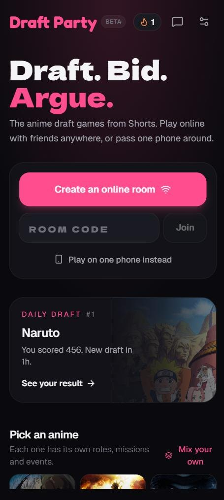
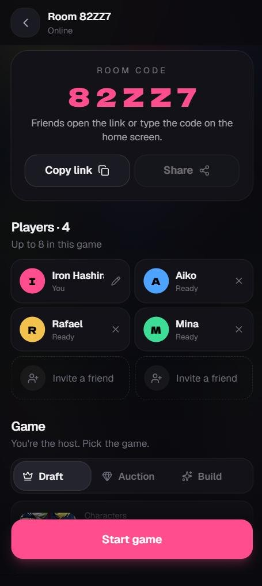
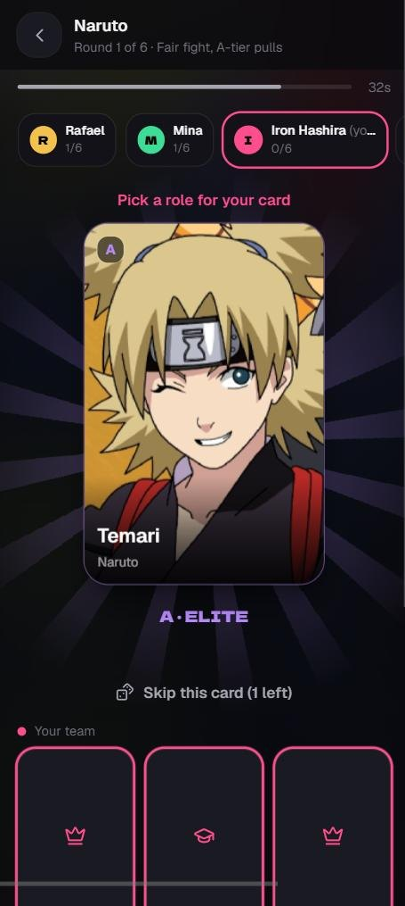
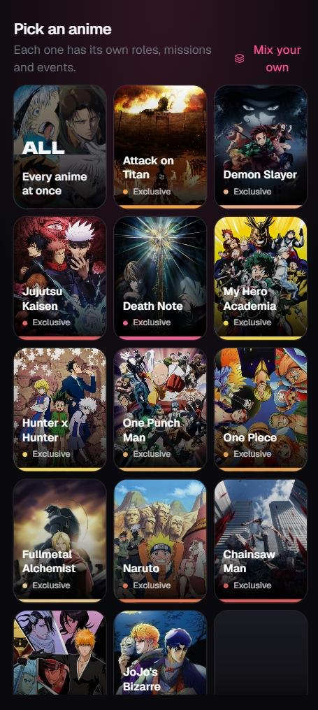
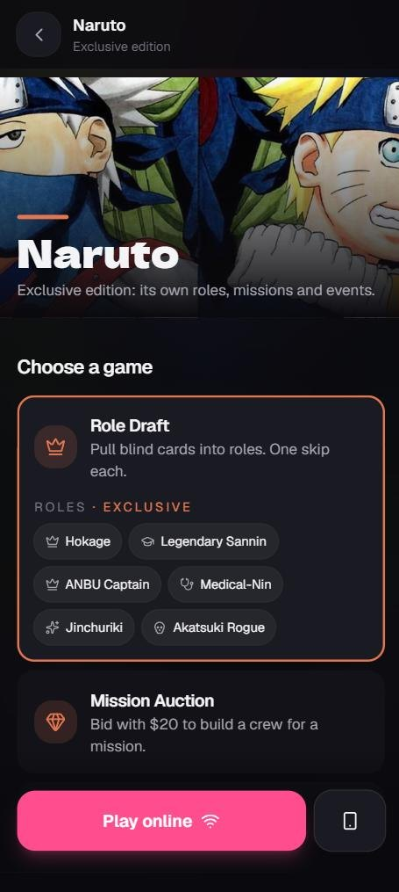
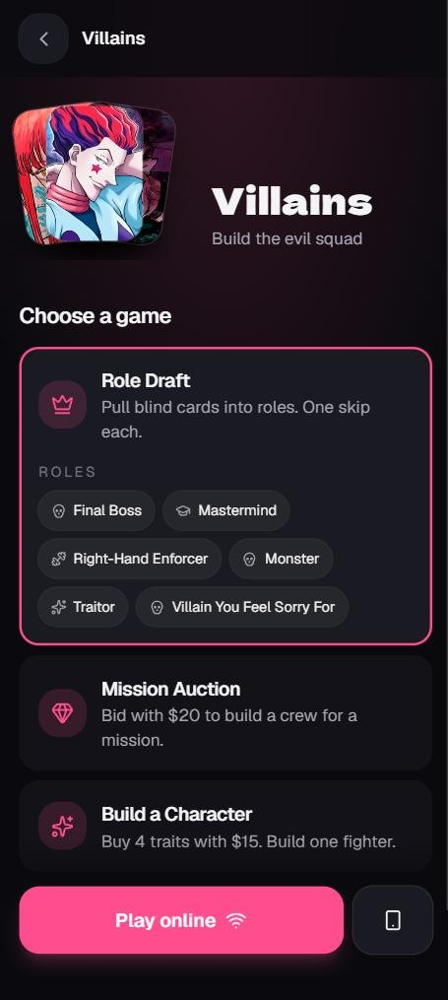
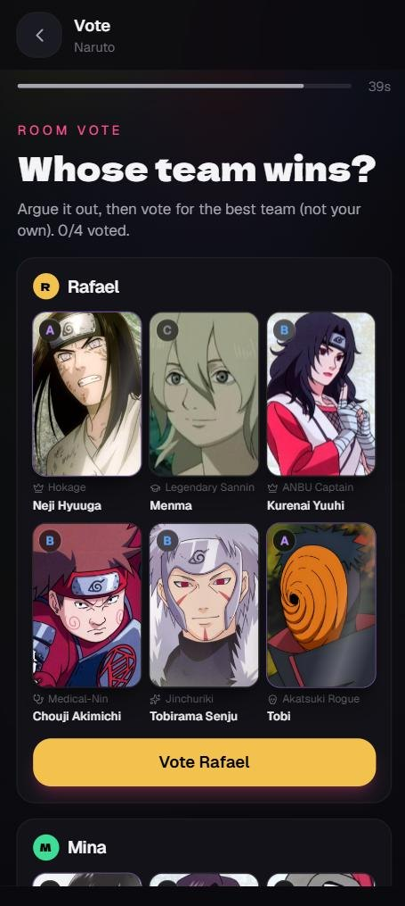
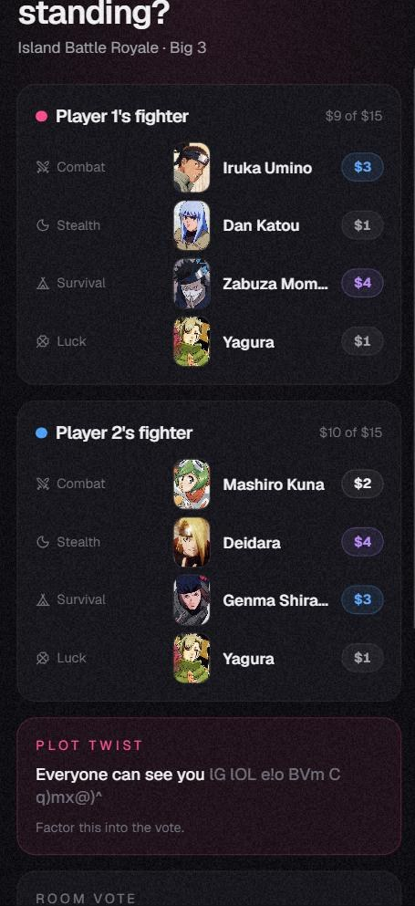

# Draft Party

**Draft. Bid. Argue.** The anime draft games from YouTube Shorts, now playable with your friends, wherever they are.

### [Play now: free, no sign-up](https://draft-party.anime-draft-party.workers.dev)

*Early beta. Feedback very welcome.*

---

Love those Shorts where people draft an anime team, bid $20 on characters, or spend $15 building someone who survives a death game? Now you can actually play them. Create a room, send the link to your friends (even in another country), and argue about who won.

  
  
  

## Play online with friends

- **One tap to make a room.** Share the link or read out the 5-letter code. No account, no download.
- **Up to 8 players** in Draft and Auction, 6 in Build a Character, 10 in Who Am I?. Friends who join mid-game watch the round, then play the next one.
- **Refresh-proof.** Lose signal or close the tab and you get your seat back.
- **Or play on one phone** and pass it around the table.

## Pick an anime, get its own edition

Tap an anime and the game changes to fit it. Naruto drafts into **Hokage, Legendary Sannin, ANBU Captain, Medical-Nin, Jinchuriki and Akatsuki Rogue**. 16 anime have their own roles, and there are 40 anime in total, including Death Note, Mob Psycho 100, Cyberpunk: Edgerunners, Frieren, Solo Leveling and Dandadan.

**Fact-checked rankings.** Every one of the 918 characters has a researched tier and trait ratings, based on official databooks, canon ranks and fan consensus. No more Temari above Tobirama.

  
  
  

## Or pick a theme

Themes work across every anime, inside one anime, or with your own mix: **Villains, Mentors, Dads, Moms, Rivals, Swordsmen, Geniuses, Main Characters, Anti-Heroes, Siblings, Monsters & Demons, Tragic Characters, Comic Relief, Best Friends, Overpowered, Must Protect, Captains and Underdogs.**

## Game modes

| Mode | How it works |
|---|---|
| **Role Draft** | Take turns pulling blind cards into roles. One skip each. *Fair fight* gives everyone the same tier every round. |
| **Mystery Auction** | $20 each. Bid on a mystery character from a clue and build a team of 4. Names are revealed at the end. |
| **Build a Character** | $15, four traits, five characters priced $1 to $5 by how good they really are at that trait. Take turns buying: once a pick is bought, it's gone. Then argue who wins the event. |
| **Who Am I?** | Three clues per character, from broad to niche. Guess on the first clue for 3 points, the second for 2, the last for 1. |
| **Daily Draft** | Everyone in the world gets the same 7 cards each day. Beat your friends and keep your streak. |

When the teams are full, **the room votes** on who won (you can't vote for yourself). Who Am I? is scored. Then save a share image for the group chat, and climb the Daily Draft leaderboard.

  
  
  

## Feedback

This is a student project in early beta. There's a **Feedback** button in the app, or open an [issue](../../issues), or reach me on GitHub [@MZRMRB](https://github.com/MZRMRB). Which anime or theme should come next?

Earlier versions are still online: [V2](https://draft-party-v2.anime-draft-party.workers.dev) · [V1](https://draft-party-v1.anime-draft-party.workers.dev)

---

Fan-made and unofficial. Not affiliated with any anime studio or publisher. Character names and images belong to their owners. Character data from <a href="https://anilist.co">AniList</a>.
