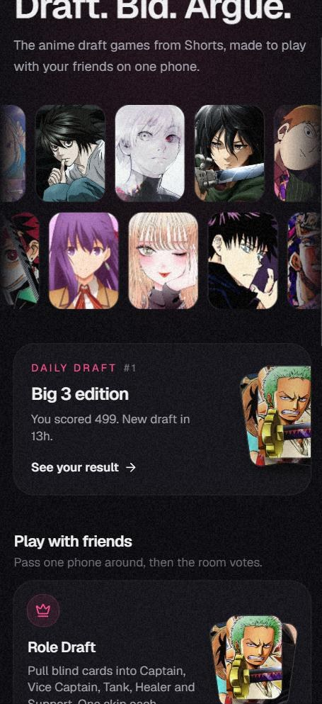
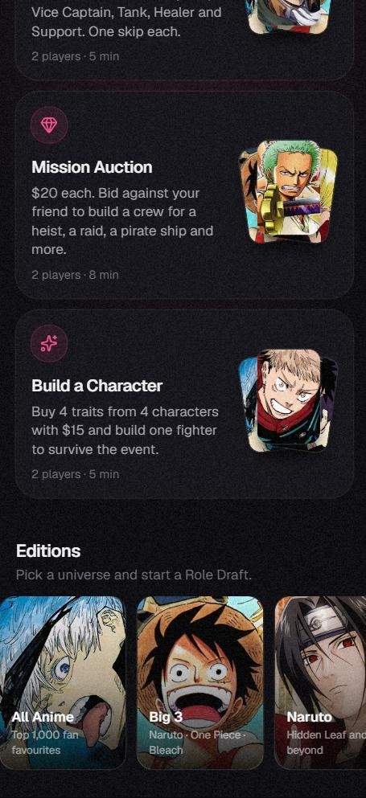
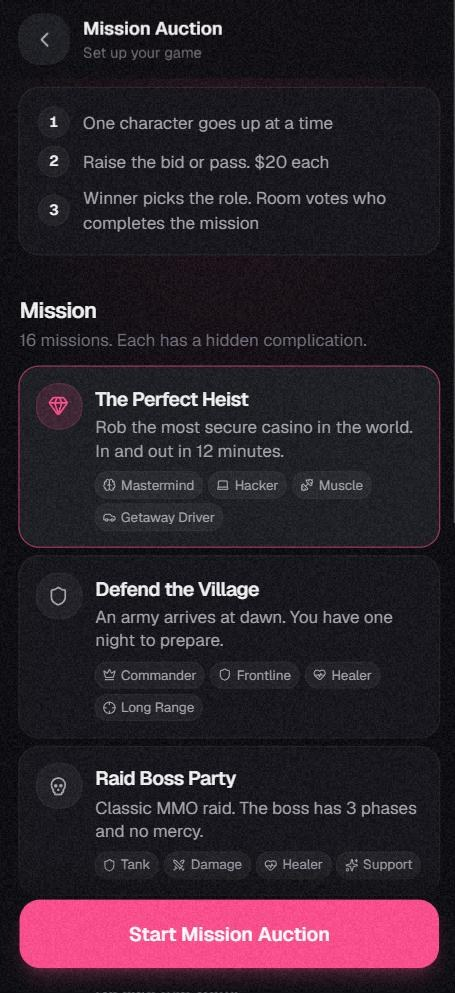
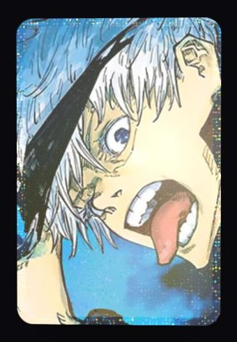
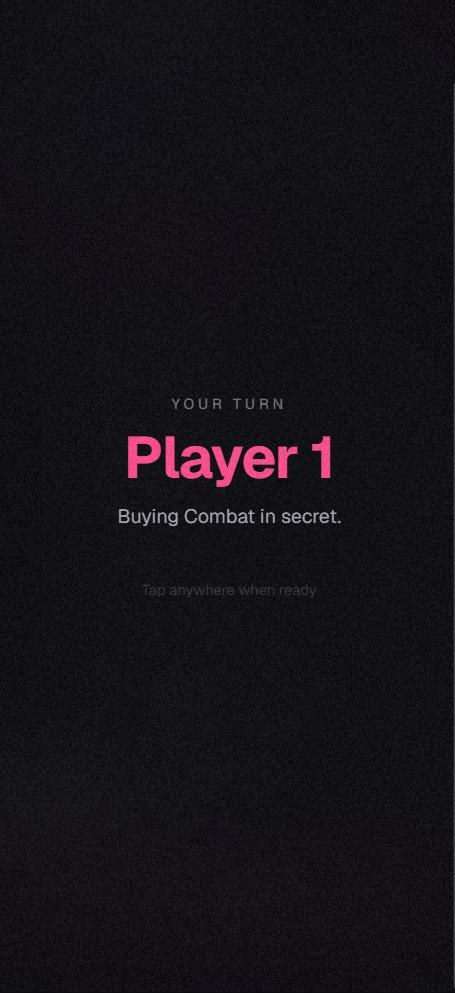

# Draft Party

**Draft. Bid. Argue.** The anime draft games from YouTube Shorts, now playable with your friends.

### [Play now: free, no sign-up](https://draft-party.anime-draft-party.workers.dev)

*Early beta. Feedback very welcome.*

---

Love those Shorts where two people draft an anime team, bid $20 on characters, or spend $15 building someone who survives a death game? There was no way to actually *play* them with friends. Now there is. Grab one phone, pass it around, argue about who won.

  
  
  

## Game modes

| Mode | How it works |
|---|---|
| **Role Draft** | Take turns pulling blind cards into Captain, Vice Captain, Tank, Healer and Support. One skip each. *Fair fight* gives both players the same tier every round. |
| **Mission Auction** | $20 each. Bid against your friend to build a crew for a mission: *The Perfect Heist, Raid Boss Party, Pirate Crew, Anime Family* and 12 more. You choose which role each character fills. Every mission hides a complication that's revealed at the end. |
| **Build a Character** | $15, four traits, five characters priced $1 to $5. Buy in secret, build one fighter, then see who survives *The Death Game, Island Battle Royale, Isekai Speedrun, Prison Break* and 16 more. Each ends with a plot twist. |
| **Daily Draft** | Everyone in the world gets the same 7 cards each day. Captain counts ×3, Vice ×2. Beat your friends and keep your streak. |

When the teams are full, **the room votes** on who won. Then save a share image for your group chat or story.

  
  
  

  
   
  Legendary pulls get a holo foil card. Secret picks hide behind a "pass the phone" screen.

## Editions

**All Anime** (top 1,000 fan favourites) · **Big 3** · Naruto · One Piece · Bleach · Dragon Ball · Jujutsu Kaisen · Demon Slayer · Attack on Titan · Black Clover · My Hero Academia · Hunter x Hunter · **Villains** · **Mentors** · **Dads**

## Feedback

This is a student project in early beta. Which mode did you play most? What mission or event should come next? Open an [issue](../../issues) or reach me on GitHub [@MZRMRB](https://github.com/MZRMRB).

Prefer the first version? [Play V1](https://v1-draft-party.anime-draft-party.workers.dev).

---

Fan-made and unofficial. Not affiliated with any anime studio or publisher. Character names and images belong to their owners. Character data from <a href="https://anilist.co">AniList</a>.
